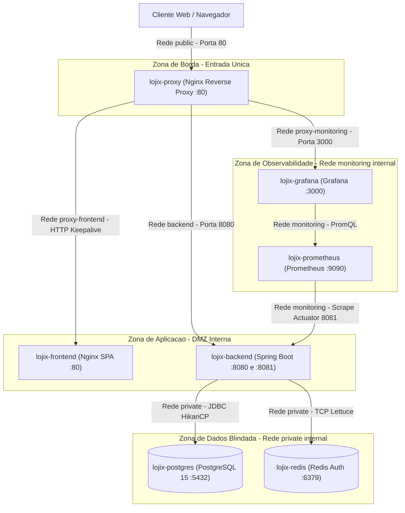

# Lojix — Store Manager Pro


---

## Visão Geral

> **Ambientes de Deploy e Execução:**
> - **Demonstração em Nuvem (Live Demo):** O frontend está publicado na **Vercel** em **[lojix-frontend.vercel.app](https://lojix-frontend.vercel.app/)**, consumindo a API REST, o banco de dados PostgreSQL e o cache Redis hospedados em containers gerenciados no **Render**.
> - **Stack Completa Local / Self-Hosted (Docker Compose):** As ferramentas de infraestrutura e observabilidade (**Nginx Reverse Proxy**, **Prometheus** e **Grafana**) foram projetadas especificamente para execução local e ambientes dedicados/self-hosted (7 containers em 6 redes isoladas). Como plataformas PaaS/Serverless de entrada não comportam nativamente redes multi-container privadas para telemetria contínua sem custos elevados de instâncias, essa suíte completa opera como código no Docker Compose para testes de carga, auditoria e simulação de produção corporativa.

Sistema web completo para gestão operacional e administrativa de pequeno e médio varejo, cobrindo controle de catálogo de produtos, categorias, campanhas promocionais com vigência temporal, gestão de colaboradores com controle de acesso baseado em papéis (**RBAC**: `ADMIN`, `ATENDENTE`, `ESTOQUISTA`) e cadastro expresso de clientes de balcão.

Diferente de projetos focados apenas em operações CRUD básicas, o objetivo central do **Lojix** foi enfrentar problemas reais de engenharia de produção em uma aplicação distribuída:

- **Segmentação de redes em containers** sem exposição de bancos ou serviços internos ao host;
- **Governança arquitetural automatizada** impedindo degradação de camadas via testes com ArchUnit;
- **Observabilidade como código** com coleta de métricas via Micrometer/Prometheus e provisionamento automático de templates no Grafana;
- **Eficiência de acesso a dados** com pool HikariCP calibrado, indexação explícita de Foreign Keys e índices funcionais no PostgreSQL, eliminação de queries *N+1*, invalidação cirúrgica de cache no Redis sincronizada com transações JPA e mapeamento em tempo de compilação via MapStruct;
- **Segurança defensiva** com inspeção binária de *Magic Bytes* para uploads no AWS S3, mascaramento de CPF em logs/e-mails (LGPD), *Optimistic Locking* mapeado para `HTTP 409 Conflict`, rate-limiting contra força bruta no Nginx e proteção contra ataques de exaustão de memória (*OOM*) em endpoints paginados.

**Contexto e Dimensionamento Operacional:** O sistema foi projetado e calibrado considerando a realidade de uma unidade de varejo com **até 20 operadores administrativos simultâneos** realizando consultas frequentes de catálogo, ajustes concorrentes de preços/estoque e cadastros rápidos de clientes no balcão. Esse recorte realista guiou escolhas concretas — do tamanho do pool de conexões no PostgreSQL até o TTL individualizado de cada região de cache no Redis.

**Arquitetura e Padrões:** O backend adota **Arquitetura em Camadas Estrita (*Strict Layered Architecture*)**, organizando o fluxo de forma unidirecional (`Controller → Service → Repository` convergindo para `Domain`), com contratos HTTP desacoplados das entidades JPA via `DTOs` e conversores `MapStruct`, além de **Inversão de Dependência (DIP)** nas fronteiras de integração externa (`StorageService` e `EmailService`). Todas as fronteiras entre pacotes são fiscalizadas automaticamente em tempo de build pelo [ArchUnit](#governança-arquitetural-com-archunit).

**Por que Arquitetura em Camadas em vez de Hexagonal "Pura" ou Microsserviços?** A decisão foi pragmática e proporcional ao domínio:

- **Sem over-engineering de microsserviços:** Para uma operação coesa de varejo com forte consistência transacional entre produtos, categorias e promoções, um monólito modular bem isolado entrega menor latência operacional, transações ACID diretas no PostgreSQL e deploy enxuto sem complexidade artificial de rede distribuída.
- **Preservação dos recursos nativos do JPA/Hibernate:** Em uma Arquitetura Hexagonal estrita, costuma-se separar completamente *POJOs de Domínio* de *JPA Entities*, exigindo mapeamento duplo a cada leitura e escrita. No Lojix, manter as anotações JPA no pacote `domain` (mas proibir via ArchUnit que `domain` conheça `service`, `controller` ou `infrastructure`) evitou *boilerplate* redundante e preservou recursos essenciais do Hibernate usados no projeto — como *Dirty Checking*, controle de concorrência otimista com `@Version` e queries `JOIN FETCH`.
- **Interfaces apenas onde há ganho real (Inversão de Dependência):** Evitou-se o antipadrão de criar pares `IService` / `ServiceImpl` para regras internas que possuem uma única implementação (`ProdutoService`, `CategoriaService`). Interfaces foram criadas exclusivamente para fronteiras externas (`StorageService` e `EmailService` na camada `service`, implementadas por `S3StorageService` e `SmtpEmailService` em `infrastructure`), permitindo isolar SDKs externos e substituir o S3 por `MockStorageService` (`@Primary`) nos testes de integração sem tocar na regra de negócio.

---

## Topologia de Redes no Docker e Infraestrutura

Estruturar o `docker-compose.yml` deste projeto foi um dos pontos de maior aprendizado prático: construí-lo do zero me deu uma noção muito mais clara de **como redes virtuais (`bridge`), resolução DNS interna e isolamento de tráfego funcionam no Docker**.

Em configurações comuns de estudo, todos os containers compartilham a rede `default` e publicam portas diretamente no host (`5432:5432`, `6379:6379`, `8080:8080`, `9090:9090`). Na prática, isso significa que um container de frontend comprometido teria rota de rede direta para tentar conexão no PostgreSQL, além de expor portas sensíveis na máquina hospedeira.

No Lojix, a infraestrutura foi desenhada sob o princípio de **Privilégio Mínimo de Rede (DMZ Multi-Tier)**, dividindo os **7 containers** em **6 redes isoladas**, onde **5 são marcadas com `internal: true`** (sem rota de saída externa e invisíveis ao host):



### Decisões de Isolamento e Hardening

| Rede | `internal` | Containers Conectados | Propósito de Segurança |
| :--- | :---: | :--- | :--- |
| `public` | `false` | `reverse-proxy`, `backend` | Permite entrada HTTP na porta `80` do Nginx e saída controlada da API para serviços externos (AWS S3 e SMTP). |
| `proxy-frontend` | `true` | `reverse-proxy`, `frontend` | Isola o servidor estático da SPA; o container React/Nginx não enxerga a API, o banco nem a internet. |
| `backend` | `true` | `reverse-proxy`, `backend` | Canal dedicado entre o gateway Nginx e a porta de aplicação `8080` do Tomcat. |
| `private` | `true` | `backend`, `postgres`, `redis` | **Camada de dados blindada.** Nem o `reverse-proxy`, nem o `frontend`, nem o host possuem rota para o PostgreSQL ou o Redis. |
| `monitoring` | `true` | `backend`, `prometheus`, `grafana` | Tráfego exclusivo de telemetria; o Prometheus coleta métricas na porta administrativa separada (`8081`). |
| `proxy-monitoring` | `true` | `reverse-proxy`, `grafana` | Permite servir os painéis do Grafana em `/grafana/` restrito por ACL de IPs privados no Nginx. |

**Boas práticas de confiabilidade e segurança nos containers:**

1. **Segurança no Container (Execução sem Root)**: Por padrão, processos em containers rodam como superusuário (`root`), o que representaria um risco severo caso uma biblioteca sofresse invasão. No Lojix, o processo Java roda sob um usuário sem privilégios (`appuser`), garantindo isolamento total do sistema operacional, além de utilizar imagem enxuta (Alpine) sem compiladores ou ferramentas desnecessárias em produção.
2. **Isolamento Físico de Portas (`8080` da API vs. `8081` de Métricas)**: Endpoints administrativos do Actuator e Prometheus contêm dados sensíveis da infraestrutura. Em vez de depender apenas de bloqueios por software, a API escuta em portas separadas: a porta `8080` atende as requisições públicas da loja, enquanto a `8081` é acessível exclusivamente pelo Prometheus dentro da rede interna. O Nginx sequer possui rota para a porta `8081`, tornando impossível o acesso externo às métricas.
3. **Inicialização à Prova de Falhas (*Healthchecks* Reais)**: Em sistemas distribuídos, containers que sobem fora de ordem costumam travar tentando conectar em bancos que ainda estão inicializando. No Docker Compose do projeto, cada serviço só é liberado após testes reais de prontidão (o PostgreSQL aceitando comandos via `pg_isready` e o Redis respondendo ao `ping` autenticado), com tolerância de tempo calibrada para a subida tranquila da JVM e das migrações do Flyway.

---

## Proteções e Otimizações no Nginx (Edge Gateway)

O Nginx (`nginx/nginx.conf`) atua como o "porteiro" de toda a infraestrutura, resolvendo problemas de rede e segurança antes mesmo que a requisição chegue ao Spring Boot ou ao React:

- **Proteção contra Força Bruta no Login (*Rate Limiting*)**: O cálculo de hash de senhas (**BCrypt**) é propositalmente pesado para a CPU. Para evitar que ataques automatizados de adivinhação de senhas (*credential stuffing*) sobrecarreguem o processamento da JVM, o Nginx limita o endpoint `/api/auth/` a no máximo 5 tentativas por segundo por IP, barrando robôs na borda da rede antes mesmo de tocar o Spring Security.
- **Conexões Persistentes com o Backend (*Keepalive*)**: Em vez de abrir e encerrar uma conexão de rede a cada clique do operador na tela, o Nginx mantém até 32 conexões ativas e reutilizáveis com o servidor Tomcat, reduzindo a latência das chamadas REST e economizando threads da JVM.
- **Respostas de Erro Padronizadas em JSON**: Se o container do backend estiver reiniciando ou temporariamente fora do ar (erros `502`, `503` ou `504`), o Nginx não devolve aquela página crua em HTML do servidor. Ele intercepta a falha e entrega um JSON limpo (`{"status":502,"message":"..."}`), permitindo que o Axios no React trate o erro e mostre um aviso amigável na interface em vez de quebrar a tela.
- **Estratégia de Cache Inteligente na SPA**: No servidor estático do frontend, arquivos versionados por hash (`.js` e `.css`) são cacheados no navegador por até 1 ano para carregamento quase instantâneo. Em contrapartida, o arquivo `index.html` nunca é cacheado, garantindo que qualquer nova versão do sistema entre em vigor para os usuários na hora, sem necessidade de `Ctrl + F5`.
- **Blindagem contra Arquivos Excessivos e Ataques Web**: O Nginx descarta imediatamente qualquer upload maior que 10 MB para impedir estouro de memória no backend, esconde a versão exata do servidor para dificultar varreduras de invasão e injeta cabeçalhos de segurança contra ataques de clique falso (*clickjacking*) e injeção de scripts.

---

## Observabilidade com Prometheus, Grafana e Provisionamento de Templates

Em vez de depender apenas da leitura manual de logs, o Lojix instrumenta toda a aplicação com **Spring Boot Actuator + Micrometer**, exportando séries temporais consumidas pelo **Prometheus** a cada **5 segundos** (`prometheus.yml` apontando para `backend:8081/actuator/prometheus`).

### Observabilidade Pronta no Startup (Dashboard como Código)

Um problema muito comum ao usar Grafana em containers é a dependência de configurações manuais pela interface ("Click-Ops"): ter que adicionar fontes de dados, desenhar gráficos com o mouse e perder tudo caso o container seja recriado.

No Lojix, toda a observabilidade opera como código (`grafana/provisioning/`). Ao subir a stack com `docker compose up -d`, a conexão com o Prometheus e os painéis já nascem 100% configurados, exibindo imediatamente em `http://localhost/grafana`:

- **Saúde da JVM e Recursos**: Consumo de memória (Heap e Non-Heap), uso de CPU, contagem de threads ativas e impacto de pausas do *Garbage Collector*.
- **Vazão e Desempenho HTTP**: Volume de requisições por segundo (RPS), tempo médio de resposta por rota e taxa de erros de cliente e servidor (`4xx` e `5xx`).
- **Eficiência do Pool HikariCP**: Conexões com o PostgreSQL ativas vs. ociosas, tempo de espera para obter conexões JDBC e identificação de filas (`pending`).
- **Gatilho Visual de Falhas de Banco**: Cartão de status em tempo real que fica **Verde** em operação normal e muda para **Vermelho vivo** se qualquer query quebrar, com gráfico diagnóstico detalhando a rota afetada e a causa (`DataIntegrityViolationException`, conflito concorrente ou timeout).
- **Aproveitamento do Cache Redis**: Medição de acertos (*cache hits*) e buscas diretas no banco (*cache misses*) por região (`produtos`, `categorias` e `promoções`).

---

## Governança Arquitetural com ArchUnit

Em projetos que crescem ao longo do tempo, a arquitetura planejada no início costuma sofrer erosão silenciosa: um desenvolvedor com pressa injeta um `Repository` direto no `Controller`, usa `@Autowired` em atributo privado ou deixa um `System.out.println` esquecido.

Para tornar as fronteiras arquiteturais **executáveis e verificáveis a cada commit**, o projeto utiliza o **ArchUnit** ([`ArchitectureTest.java`](backend/src/test/java/com/example/lojix/architecture/ArchitectureTest.java)), validando o bytecode compilado durante a fase `test` do Maven:

| Regra ArchUnit | O que protege |
| :--- | :--- |
| `controllers_should_not_depend_on_repositories` | Impede atalhos que pulem regras de negócio, cache e controle transacional da camada `service`. |
| `domain_should_not_depend_on_outside` | Garante que entidades e enums de domínio permaneçam puros, sem acoplamento reverso com web, serviços ou infraestrutura. |
| `services_should_not_depend_on_controllers` | Assegura fluxo unidirecional de dependências e impede ciclos entre pacotes. |
| `controllers_must_be_suffixed_and_annotated` | Padroniza nomenclatura (`*Controller`) e anotação `@RestController`. |
| `services_must_be_suffixed_and_annotated` | Padroniza nomenclatura (`*Service`) e estereótipo `@Service`. |
| `no_field_injection` | Proíbe `@Autowired` em campos (exceto classes `*Impl` geradas pelo MapStruct), forçando **injeção via construtor** com campos `final` para imutabilidade e facilidade de teste. |
| `no_system_out_println` | Bloqueia uso de `System.out` / `System.err`, exigindo logging estruturado via SLF4J/Logback. |
| `no_generic_exceptions` | Proíbe lançar `Exception`, `RuntimeException` ou `Throwable` crus, forçando o uso de exceções semânticas de domínio tratadas no `@ControllerAdvice`. |

---

## Modelagem de Dados e Diagrama Entidade-Relacionamento

O schema relacional é versionado pelo **Flyway** (`V1__create_tables.sql`), mantendo `spring.jpa.hibernate.ddl-auto=none` em produção para que nenhuma alteração estrutural aconteça fora de migrações auditáveis.


### Salvaguardas e Inteligência no Banco de Dados (PostgreSQL)

A integridade e o desempenho do sistema não dependem apenas da camada Java; o próprio schema relacional impõe regras rígidas de consistência e estratégias conscientes de indexação:

- **Indexação Estratégica de Chaves Estrangeiras**: Diferente de outros bancos (como o MySQL InnoDB), o PostgreSQL **não** cria índices automáticos para Foreign Keys. Foram criados índices explícitos nas relações mais consultadas (Produtos com Categorias e Promoções), garantindo que consultas com `JOIN` ocorram em alta velocidade via índice e eliminando travamentos de tabela inteira (*table locks*) ao atualizar ou excluir registros relacionados.
- **Autenticação Rápida e Prevenção de E-mails Duplicados**: Em vez de fazer varreduras lentas linha por linha (*Sequential Scan*) quando o usuário digita seu e-mail no login, foi criado um **índice funcional que normaliza o texto em minúsculas**. Isso acelera a autenticação e impede no nível de banco que duas contas sejam criadas com o mesmo e-mail apenas mudando maiúsculas e minúsculas (`Admin@teste.com` vs. `admin@teste.com`).
- **Segurança contra Enumeração de URLs (UUID)**: O identificador de usuários utiliza UUID em vez de IDs sequenciais (`1, 2, 3`), impedindo que agentes externos descubram o volume total de usuários da loja ou tentem adivinhar rotas administrativas na URL.
- **Regras de Negócio Blindadas no Banco (*Constraints CHECK*)**: O banco rejeita diretamente qualquer dado inconsistente na raiz — impedindo preços e estoques negativos, taxas de desconto fora da faixa de 0% a 100%, ou promoções cuja data de término seja anterior ao início.
- **Políticas de Integridade Referencial (*Foreign Keys*)**:
  - **Bloqueio de exclusão acidental (`RESTRICT`)**: Impede apagar categorias que ainda possuam produtos vinculados a elas no catálogo.
  - **Preservação de catálogo (`SET NULL`)**: Se uma campanha promocional for encerrada ou removida, os produtos voltam automaticamente ao preço original sem serem apagados.
  - **Desativação Lógica (*Soft Delete*)**: Produtos desativados saem da vitrine da loja sem destruir referências históricas de vendas anteriores.
- **Precisão Financeira Estrita**: Armazenamento com precisão decimal exata (`NUMERIC`) no banco acoplado a `BigDecimal` no Java, eliminando erros clássicos de arredondamento de centavos causados por tipos de ponto flutuante (`double`/`float`).

---

## Engenharia de Backend, Performance e Resiliência

### 1. Caching Distribuído no Redis com Invalidação Cirúrgica e Consistência Transacional

Em vez de sobrecarregar o PostgreSQL a cada consulta de catálogo, o sistema utiliza o **Redis** como camada de cache de baixa latência em memória. A estratégia foi desenhada com três cuidados fundamentais de produção:

#### A. Tempo de Vida (TTL) Calibrado por Tipo de Dado
Nem toda informação muda na mesma velocidade. Cada região de cache possui um prazo de expiração (*TTL*) proporcional à sua frequência de alteração no varejo:

| Região de Cache | Tempo de Vida (TTL) | Motivação no Negócio |
| :--- | :---: | :--- |
| `categoriasCache` | **12 horas** | Dados estruturais de catálogo que raramente sofrem alteração durante o expediente. |
| `promocaoCache` | **60 minutos** | Campanhas promocionais que costumam ser ativadas ou ajustadas pontualmente. |
| `produtosCache` | **30 minutos** | Consultas individuais por ID; equilibra respostas em milissegundos com o frescor de estoque e preço. |
| `clientesCache` / `funcionariosCache` | **10 minutos** | Dados operacionais de colaboradores e clientes consultados com frequência no atendimento. |

*(Nota de arquitetura: Listagens paginadas não são cacheadas no Redis devido à alta variabilidade de filtros e conhecidas restrições de serialização do `PageImpl` do Spring; em vez disso, a paginação é acelerada diretamente no PostgreSQL via projeções DTO enxutas e índices dedicados).*

#### B. Invalidação Cirúrgica (Prevenção de *Cache Stampede*)
Ao encerrar uma promoção que afetava apenas alguns itens, a abordagem ingênua seria limpar o cache de produtos inteiro (`allEntries = true`). Isso derrubaria milhares de itens da memória de uma só vez, fazendo com que as próximas requisições sobrecarregassem o PostgreSQL simultaneamente para reconstruir o cache (*Cache Stampede*). 

No Lojix, o serviço consulta quais produtos pertenciam àquela promoção e **remove exclusivamente as chaves desses itens específicos**, mantendo todo o restante do catálogo aquecido no Redis.

#### C. Sincronização Estrita com o Banco (`transactionAware`)
Se a aplicação gravasse ou apagasse dados no Redis antes de o banco confirmar a transação, qualquer falha ou *rollback* no PostgreSQL deixaria dados falsos ("fantasmas") salvos no cache. 

Ao ativar `.transactionAware()` no gerenciador de cache, as operações no Redis só são disparadas **após a confirmação definitiva (*commit*) da transação relacional**, garantindo consistência total entre o que está no cache e o que está gravado no banco.

*(A serialização em JSON conta ainda com suporte nativo a datas em formato ISO-8601 via `JavaTimeModule`, evitando erros de compatibilidade com campos `LocalDate` e `LocalDateTime` do Java).*

### 2. Dimensionamento do Pool de Conexões (HikariCP) e Detecção de Vazamentos

Um erro clássico em backend é inflar o pool de conexões com 50 ou 100 conexões achando que "mais conexões = mais velocidade". No PostgreSQL (onde cada conexão gera um processo separado no Linux), o excesso de conexões causa o efeito contrário: degradação de CPU por troca excessiva de contexto (*context switching*) e contenção de disco.

O pool de banco do Lojix foi calibrado em [`application-prod.properties`](backend/src/main/resources/application-prod.properties) sob dois pilares:

- **Dimensionamento Consciente e Parametrizável (Baseline de 12 Conexões)**: O tamanho ideal de um pool varia conforme o hardware hospedeiro (núcleos de processador e I/O de disco). Com base na fórmula oficial do HikariCP (`conexões = núcleos * 2 + discos`), estipulou-se um *baseline* padrão de **12 conexões máximas** (calibrado para servidores típicos de 4 a 6 vCPUs com folga para até 20 operadores simultâneos). Esse valor é totalmente parametrizável via variável de ambiente (`${HIKARI_MAX_POOL_SIZE:12}`), permitindo ajuste dinâmico conforme a infraestrutura de deploy crescer.
- **Alerta Automático de Vazamento de Conexão (*Leak Detection*)**: Um dos piores problemas em produção é uma transação travar ou esquecer de devolver a conexão para o pool — aos poucos todas as conexões somem e a API congela. Configuramos um limite de 15 segundos (`leak-detection-threshold=15000`): se qualquer consulta segurar uma conexão por mais tempo que isso, o HikariCP emite um alerta imediato no log com o *stack trace* exato da linha de código que causou o problema.
- **Renovação Saudável de Conexões**: Conexões ociosas são recicladas periodicamente (`idle-timeout` e `max-lifetime`), evitando que o banco de dados ou firewalls de nuvem derrubem conexões antigas de surpresa.

### 3. Eliminação do Problema N+1 e Paginação Otimizada no Hibernate

Consultas mal estruturadas no Spring Data JPA são as maiores causas de lentidão e estouro de memória em produção. No Lojix, o acesso a dados foi desenhado sob três salvaguardas:

- **Busca Cirúrgica com Projeções em DTO**: Em listagens como a de Clientes, a API não carrega entidades JPA completas para a memória da aplicação. A consulta JPQL projeta o DTO diretamente no banco, trazendo apenas os dados necessários para a interface em uma única ida ao PostgreSQL, sem o overhead de gerenciar instâncias e rastrear alterações (*dirty checking*) na JVM.
- **Resolução do N+1 com Paginação Nativa no Banco**: Ao listar produtos vinculados a categorias e promoções, a abordagem padrão do JPA dispararia dezenas de queries extras no banco — uma para cada linha exibida (o clássico problema *N+1*). O Lojix resolve isso combinando `JOIN FETCH` com uma consulta de contagem desacoplada (`countQuery` dedicada), permitindo que o PostgreSQL resolva os relacionamentos e a paginação (`LIMIT`/`OFFSET`) diretamente no SQL, sem que o Hibernate precise carregar a tabela inteira na memória para paginar.
- **Teto Protetor de Paginação contra Ataques de Memória**: Para impedir que um usuário mal-intencionado envie `?size=1000000` na URL e tente estourar a memória RAM da JVM com milhões de registros de uma vez (*Denial of Service por Out of Memory*), uma trava global (`max-page-size=50`) limita qualquer listagem a no máximo 50 registros por requisição.

### 4. Controle de Concorrência Web com Versão Otimista (`HTTP 409 Conflict`)

No varejo, é comum dois operadores abrirem a tela do mesmo produto ao mesmo tempo. Se um alterar o preço e o outro alterar o estoque logo em seguida, a gravação tradicional faria com que o último sobrescrevesse as mudanças do primeiro sem ninguém perceber (o clássico problema de *Lost Update*).

No Lojix, as entidades de catálogo e campanhas (`Produto` e `Promocao`) possuem controle de versão otimista (`@Version`):
- O banco valida se o número da versão do registro ainda é o mesmo no momento da gravação.
- Se outro usuário já tiver alterado o produto, a segunda requisição é interceptada pelo `CustomExceptionHandler` e devolve **`HTTP 409 Conflict`**, orientando o operador a recarregar a tela para ver os dados atualizados.
- **Vantagem:** Garante consistência total sem precisar travar linhas no banco de dados (*Pessimistic Locks*), mantendo a API rápida e destravada.

---

### 5. Armazenamento Seguro de Imagens no AWS S3 (Proteção Multicamadas)

O upload de fotos de perfil (`S3StorageService`) com o **AWS SDK v2** foi blindado contra os principais vetores de ataque em uploads web:

- **Inspeção Real por *Magic Bytes* (Adeus a Extensões Falsas)**: Um invasor pode facilmente renomear um arquivo malicioso executável para `foto.jpg` para burlar validações simples (*MIME Spoofing*). O sistema inspeciona a assinatura binária real nos primeiros bytes do arquivo, aceitando exclusivamente formatos legítimos de imagem (JPEG, PNG e WebP).
- **Prevenção contra Sobrescrita de Pastas (*Path Traversal*)**: O nome original enviado pelo usuário é descartado. A imagem é salva sob um identificador determinístico isolado (`usuarios/{id}/foto-perfil`), impedindo que nomes maliciosos tentem navegar entre diretórios.
- **Bucket 100% Privado com URLs Temporárias (*Presigned URLs*)**: Nenhuma imagem no S3 fica aberta publicamente na internet. A visualização ocorre através de links assinados criptograficamente com prazo de validade curto, expirando automaticamente após o uso.
- **Proteção contra Falhas de Rede (*Timeouts Fail-Fast*)**: O cliente da AWS possui timeouts rigorosos (10s para chamadas e 5s por tentativa), garantindo que uma instabilidade na nuvem externa nunca congele as threads do servidor Tomcat.

---

### 6. Notificações Assíncronas de Boas-Vindas e Resiliência (@Async + LGPD)

Ao cadastrar um cliente no balcão, o sistema dispara um e-mail de boas-vindas com três cuidados de arquitetura:

- **Sem Espera no Balcão (`@Async`)**: A negociação com servidores SMTP leva de 2 a 5 segundos. O envio roda em uma thread paralela em segundo plano, permitindo que o atendente receba a confirmação do cadastro (`201 Created`) em milissegundos.
- **Falha de E-mail Não Cancela Cadastro**: Caso o servidor de e-mail esteja temporariamente fora do ar ou sem conexão, a falha é registrada apenas no log e **jamais cancela o cadastro do cliente** que já foi salvo com sucesso no banco. Além disso, em desenvolvimento local o envio pode ser desativado, permitindo testar toda a aplicação sem precisar configurar credenciais reais de e-mail.
- **Privacidade por Design (LGPD)**: O CPF do cliente é automaticamente mascarado tanto nos logs da aplicação quanto no corpo do e-mail enviado (`***.456.789-**`), impedindo a exposição de dados pessoais.

---

### 7. Conversão de Alta Performance (MapStruct) e Validação de Negócio

- **Mapeamento em Tempo de Compilação (MapStruct)**: Toda conversão entre Entidades e DTOs é gerada pelo compilador em código Java puro. Isso elimina o custo de processamento de bibliotecas antigas que usavam *Reflection* (como o ModelMapper) e permite aplicar regras dinâmicas no próprio mapeamento — como calcular na hora se o produto tem desconto promocional ativo.
- **Validação de Maioridade na Borda (`@MaiorDeIdade`)**: Regra de negócio personalizada integrada ao Jakarta Bean Validation (`@Valid`), barrando cadastros de menores de 18 anos diretamente na entrada do DTO com retorno limpo `400 Bad Request`, antes mesmo de acionar a camada de serviço.

---

## Frontend em React Puro, CSS Modules e Decisões de UX

O frontend foi desenvolvido deliberadamente em **React 18 puro**, sem depender de bibliotecas visuais pesadas de componentes de terceiros (como Material UI, Ant Design ou Bootstrap), garantindo controle total da estilização e performance máxima:

### 1. Arquitetura e Engenharia do Cliente
- **Bundle Extremamente Leve (~90 kB gzipped)**: Sem o peso de frameworks de UI inchados, a aplicação carrega instantaneamente mesmo em conexões modestas.
- **Isolamento de Estilos com CSS Modules (`*.module.css`)**: Todo componente possui estilos com escopo local gerado no build, eliminando riscos de colisão global de classes e facilitando a manutenção.
- **Gestão de Estado com TanStack React Query v5**: Substitui cascatas manuais e propensas a bugs de `useEffect` e `useState` por cache declarativo no navegador (5 minutos de *staleTime*), estados visuais automáticos de carregamento e sincronização imediata após cadastros e edições.
- **Interceptors Axios e Controle de Sessão**: Injeção automática do token Bearer JWT em todas as requisições e redirecionamento instantâneo para o login em caso de expiração (`401`), além de bloqueio de rotas por papel (`ProtectedRoute`).

### 2. Design e Experiência do Operador de Loja (UX)
- **Cadastro Ágil de Clientes no Balcão**: Formulário enxuto e sem atrito, focado exclusivamente nos dados essenciais de contato (Nome, CPF com máscara dinâmica, Data de Nascimento e E-mail), gerando os vínculos relacionais internamente de forma transparente para o atendente.
- **Tabelas Focadas na Operação**: As listagens priorizam atributos relevantes para o negócio (como Nome da Categoria, Preços e Quantidade), mantendo a tela limpa de chaves primárias e ruídos técnicos de banco de dados.
- **Indicadores Visuais Inteligentes**: Valores monetários em Real (`R$ XX,XX`), badges de cores por nível de acesso dos funcionários e alertas visuais automáticos na tabela de produtos para **estoque crítico (≤ 5 unidades ou esgotado)** e **validade próxima ou vencida (≤ 15 dias)**.

---

## Estratégia de Testes Automatizados

Diferente de projetos que testam apenas mocks isolados, a suíte do backend conta com **62 testes automatizados** combinando **testes de arquitetura (ArchUnit)**, **testes unitários de infraestrutura** e **testes de integração ponta a ponta (`@SpringBootTest` + `MockMvc`)** rodando no perfil `test` com `@Transactional` (garantindo *rollback* automático e isolamento total entre cenários).

Para manter os testes legíveis e evitar duplicação de código de setup, foi implementado o padrão **Test Data Builder** (`UsuarioTestBuilder`, `FuncionarioTestBuilder`, `ClienteTestBuilder`, `ProdutoRequestDTOBuilder`, `AuthTestFactory`) aliado a um *Test Double* para armazenamento em nuvem (`MockStorageService`).

| Classe de Teste | Testes | Escopo Validado |
| :--- | :---: | :--- |
| `ArchitectureTest` | 8 | Isolamento entre `controller`, `service`, `domain` e `repository`, proibição de *field injection*, `System.out` e exceções genéricas. |
| `FuncionarioControllerTest` | 9 | Fluxo completo de colaboradores, autorização RBAC (`ADMIN` vs demais roles), validação de CPF/idade (`@MaiorDeIdade`) e conflitos. |
| `PromocaoControllerTest` | 8 | Criação, listagem paginada, associação com produtos, cálculo de desconto e desativação com invalidação de cache. |
| `CategoriaControllerTest` | 7 | Cadastro, unicidade de nome, paginação, edição e restrições de permissão por perfil. |
| `ProdutoControllerTest` | 7 | CRUD completo de catálogo, filtro por categoria, soft delete, validações de preço/estoque e autenticação JWT. |
| `AuthControllerTest` | 6 | Autenticação com credenciais válidas/inválidas, emissão de token JWT e bloqueio de rotas protegidas (`401`/`403`). |
| `ClienteControllerTest` | 6 | Cadastro de clientes, unicidade de CPF, paginação com projeção DTO e consulta por ID. |
| `S3StorageServiceTest` | 4 | Upload válido, rejeição por tamanho máximo excedido, tipo inválido e inspeção de assinatura binária (*Magic Bytes*). |
| `SmtpEmailServiceTest` | 3 | Montagem do template HTML de boas-vindas, disparo via `JavaMailSender`, modo simulado (`mailEnabled=false`) e isolamento de falhas SMTP. |
| `CustomExceptionHandlerTest` | 3 | Tratamento global de exceções, mapeamento de status HTTP e instrumentação de métricas de erros de banco no Micrometer (`db.query.errors`). |
| `LojixApplicationTests` | 1 | Smoke test de subida íntegra do contexto do Spring Boot no perfil de testes. |
| **Total** | **62** | |

---

## CI/CD, Qualidade de Código (SonarCloud) e Deploy

### Pipelines Isoladas no GitHub Actions

O repositório possui **3 workflows independentes** em `.github/workflows/` configurados com filtros de caminho (`paths`) e cancelamento automático de execuções concorrentes obsoletas (`concurrency.cancel-in-progress: true`), evitando gastar minutos de CI em áreas que não foram tocadas no commit:

1. **`backend-ci.yml`**: Compila o projeto em Java 17 com cache Maven, executa toda a suíte de **62 testes (incluindo ArchUnit)**, gera o relatório XML de cobertura com **JaCoCo** e envia a análise estática de qualidade, *code smells* e vulnerabilidades (SAST) para o **SonarCloud**.
2. **`frontend-ci.yml`**: Instala dependências limpas via `npm ci` em Node 18, executa testes e valida o build otimizado de produção (`npm run build`).
3. **`docker-ci.yml`**: Valida o schema estrutural do `docker-compose.yml` (`docker compose config -q`) e testa a sintaxe real dos arquivos de configuração do Nginx (`nginx -t`) dentro de containers `nginx:alpine` efêmeros.

### Governança e Análise Estática de Código (SonarCloud + JaCoCo)

A cada commit no backend, a pipeline dispara uma auditoria estática automatizada no **SonarCloud** combinada ao relatório de cobertura do **JaCoCo**, assegurando a saúde do código através de 4 dimensões:

- **Quality Gate Rigoroso:** Bloqueio automático de pull requests e deploys que introduzam débitos técnicos ou violem critérios de qualidade do repositório;
- **Segurança da Aplicação (SAST):** Varredura contínua contra vulnerabilidades conhecidas, falhas de injeção e violações de boas práticas de segurança;
- **Manutenibilidade e *Clean Code*:** Detecção precoce de *code smells*, trechos duplicados e complexidade ciclomática excessiva em métodos de negócio;
- **Auditoria de Cobertura de Testes:** Validação linha a linha de cobertura nas camadas de serviço, domínio e controladores RESTful testadas pela suíte de 62 testes.

### Estratégia de Deploy e Ambientes de Execução

O projeto conta com uma abordagem híbrida consciente entre demonstração pública ágil em nuvem e infraestrutura corporativa completa conteinerizada:

#### 1. Demonstração Pública em Nuvem (Cloud PaaS)
- **Frontend — Vercel ([lojix-frontend.vercel.app](https://lojix-frontend.vercel.app/))**: Deploy contínuo da SPA React servida via Edge CDN global de baixa latência e com HTTPS nativo.
- **Backend, Banco e Cache — Render**: Deploy conteinerizado da API Spring Boot conectado a instâncias em nuvem gerenciadas de **PostgreSQL 15** e **Redis** sob perfil de produção (`prod`).

#### 2. Infraestrutura Completa e Observabilidade (Local / Self-Hosted com Docker Compose)
- **Nginx Reverse Proxy, Prometheus e Grafana**: A suíte de infraestrutura de rede e telemetria foi configurada para execução local (`docker compose up -d`) e ambientes dedicados (*on-premise*, VPS ou clusters Kubernetes).
- **Por que Nginx, Prometheus e Grafana operam localmente?** Plataformas PaaS/Serverless gratuitas ou de entrada (como Vercel e Render Free) são focadas na entrega simplificada de aplicações web públicas e não comportam nativamente redes multi-container privadas para scraping contínuo de métricas sem custos expressivos de infraestrutura. Manter toda a observabilidade como código no Docker Compose permite simular e auditar a operação corporativa completa (JVM, HikariCP, logs e tráfego Nginx) com zero custo e total fidelidade técnica.

---

## Estrutura do Projeto

```text
lojix/
├── .github/workflows/          # Pipelines CI isoladas (backend-ci, frontend-ci, docker-ci)
├── assets/                     # Capturas de tela das interfaces do sistema
├── backend/
│   ├── src/main/java/com/example/lojix/
│   │   ├── common/             # Handler global de exceções (HTTP 409/400/401) e @MaiorDeIdade
│   │   ├── config/             # Configurações de Redis, AWS S3 (Timeouts), CORS e OpenAPI
│   │   ├── controller/         # Controllers RESTful finos
│   │   ├── domain/             # Entidades JPA (@Entity, @Version) e Enums (UserRole)
│   │   ├── dto/                # Contratos de entrada/saída e validações Jakarta
│   │   ├── infrastructure/     # Repositórios JPA, S3StorageService, SmtpEmailService, JWT Security
│   │   ├── mapper/             # Interfaces MapStruct geradas em tempo de compilação
│   │   ├── service/            # Regras de negócio, transações e orquestração de cache
│   │   └── util/               # Utilitários (ex: MaskUtils para proteção de CPF/LGPD)
│   ├── src/main/resources/
│   │   ├── db.migration/       # Migrações SQL versionadas pelo Flyway
│   │   ├── application.properties
│   │   ├── application-dev.properties
│   │   ├── application-prod.properties
│   │   └── application-test.properties
│   ├── src/test/java/          # Suíte JUnit 5, MockMvc, ArchUnit e Test Data Builders
│   └── Dockerfile              # Build multi-stage Maven -> JRE 17 Alpine (non-root)
├── frontend/
│   ├── src/
│   │   ├── components/         # Layout, Navbar, Modal, ProtectedRoute (CSS Modules)
│   │   ├── context/            # Contexto de sessão e autenticação JWT
│   │   ├── pages/              # Dashboard, Produtos, Categorias, Promoções, Funcionários, Clientes
│   │   └── services/           # Cliente Axios e interceptors HTTP
│   ├── nginx.conf              # Servidor SPA com cache imutável em /static/
│   └── Dockerfile              # Build multi-stage Node 18 -> Nginx Alpine
├── grafana/
│   ├── dashboards/             # Template JSON (spring-boot-statistics.json)
│   └── provisioning/           # Provisionamento automático de datasources e dashboards
├── nginx/
│   └── nginx.conf              # Reverse Proxy (rate-limit, keepalive, gzip, security headers)
├── docker-compose.yml          # Orquestração dos 7 serviços e 6 redes isoladas
├── prometheus.yml              # Configuração de scrape no Actuator (:8081)
└── .env.example                # Exemplo documentado de variáveis de ambiente
```

---

## Como Executar Localmente

### Opção 1: Stack Completa com Docker Compose (Recomendado)

Sobe todos os 7 containers (`reverse-proxy`, `frontend`, `backend`, `postgres`, `redis`, `prometheus` e `grafana`) com as redes internas e dashboards provisionados:

```bash
# 1. Clone o repositório
git clone https://github.com/queirogaraffael/lojix.git
cd lojix

# 2. Crie o arquivo .env a partir do modelo e configure as variáveis
cp .env.example .env

# 3. Construa as imagens e suba toda a stack em background
docker compose up -d --build

# 4. Verifique o status de saúde dos containers
docker compose ps
```

- **Aplicação Web (via Nginx Reverse Proxy):** `http://localhost`
- **Dashboards do Grafana:** `http://localhost/grafana` (usuário `admin` e senha definida em `GF_ADMIN_PASSWORD` no `.env`)
- **Healthcheck do Gateway:** `http://localhost/healthz`

> **Guia de preenchimento do `.env`:**
> - **Banco de Dados e JWT:** Configure credenciais para `DB_NAME`, `DB_USER`, `DB_PASSWORD` e uma chave segura para `JWT_SECRET`;
> - **Acesso Inicial do Administrador:** `ADMIN_USERNAME` e `ADMIN_PASSWORD` definem o operador administrador inicial da loja (criado de forma idempotente pelo `UserAdminInitializer` no primeiro boot);
> - **Acesso ao Grafana:** `GF_ADMIN_PASSWORD` define a senha de acesso aos dashboards de métricas;
> - **Integrações Externas (Opcionais no modo local):**
>   - **AWS S3:** Só precisa ser preenchido caso deseje testar o upload real de fotos de perfil;
>   - **E-mail (SMTP):** Mantido como `MAIL_ENABLED=false` por padrão, simulando os disparos em log sem travar a aplicação nem exigir credenciais SMTP reais.

### Opção 2: Execução em Modo Desenvolvimento (Sem Docker)

O perfil `dev` utiliza banco **H2 em memória**, cache local simplificado e habilita o **Swagger UI** (`/swagger`), permitindo rodar e depurar rapidamente na máquina local sem depender de PostgreSQL ou Redis externos:

```bash
# Terminal 1 — Backend (porta 8080)
cd backend
./mvnw spring-boot:run -Dspring-boot.run.profiles=dev

# Terminal 2 — Frontend (porta 3000)
cd frontend
npm install
npm start
```

---

## Imagens do Sistema

### Autenticação e Dashboard Administrativo


### Gestão de Produtos e Promoções


### Gestão de Categorias


### Gestão de Funcionários e Clientes de Balcão


---

## Evolução e Comparativo entre Projetos

Para contextualizar minha evolução técnica em arquitetura de software e infraestrutura dentro do domínio de varejo, o **Lojix** representa o próximo passo natural após o [Self-Checkout Retail Desktop](https://github.com/queirogaraffael/self-checkout-retail-desktop).

Enquanto no projeto anterior o objetivo foi implementar **manualmente em Java puro + Hibernate + Swing** tudo o que um framework moderno abstrai (container de IoC manual, ciclo de vida explícito do `EntityManagerFactory`, controle manual de sessão com threads daemon e retry com *Exponential Backoff + Jitter*), no **Lojix** o foco foi dominar o ecossistema **Spring Boot em nível de produção**, compreendendo exatamente o que acontece por baixo das abstrações e adicionando camadas reais de arquitetura distribuída:

| Dimensão Técnica | Self-Checkout Retail Desktop | Lojix — Store Manager Pro |
| :--- | :--- | :--- |
| **Arquitetura e Interface** | Desktop MVC (Swing) | Arquitetura em Camadas Estrita + DIP nas integrações (REST API) + SPA em React Puro (CSS Modules) |
| **Injeção de Dependência e Persistência** | IoC manual + `EntityManager` isolado por tentativa | Spring IoC (construtor estrito validado por ArchUnit) + Spring Data JPA + Flyway + HikariCP calibrado |
| **Concorrência** | Optimistic Locking (`@Version`) + Retry com Backoff Exponencial e Jitter | Optimistic Locking (`@Version`) traduzido para semântica REST (`HTTP 409 Conflict`) |
| **Performance e Cache** | Batch `SELECT ... IN` no MySQL | Redis distribuído (`transactionAware`, TTLs por agregado e invalidação cirúrgica) + MapStruct + `JOIN FETCH` + Indexação explícita de FKs e índices funcionais |
| **Infraestrutura e Redes** | Uma JVM local por terminal | 7 containers orquestrados em **6 redes Docker isoladas (DMZ)** + Nginx Reverse Proxy |
| **Observabilidade** | Logs locais | **Prometheus + Grafana** com templates e datasources provisionados como código |
| **Integrações Externas** | Geração de NF em arquivo local | **AWS S3** (Magic Bytes + Presigned URLs) e **SMTP Assíncrono (`@Async`)** |
| **Qualidade, Testes e CI/CD** | 30 testes unitários (JUnit 4 + Mockito) | **62 testes** (Integração `MockMvc` + Unitários + **ArchUnit**) em pipelines GitHub Actions + JaCoCo + SonarCloud + Deploy (Vercel/Render) |

Construir primeiro os mecanismos "na unha" sem Spring no projeto desktop e depois projetar o Lojix com Spring Boot, Redis, S3, redes Docker segmentadas e observabilidade tornou cada configuração deliberada — sabendo exatamente qual problema cada ferramenta resolve e quais *trade-offs* ela introduz.

---

## Autores e Contribuições

- **[Raffael Queiroga](https://github.com/queirogaraffael)** — Concepção geral, Arquitetura e Engenharia de Backend, Modelagem de Banco de Dados, Infraestrutura Docker/Nginx, Observabilidade, Segurança e Refatoração/Evolução Completa do Frontend.
- **[Felipe Azevedo](https://github.com/Lipe-Azevedo)** — Colaboração inicial na prototipagem e estruturação base das primeiras telas em React.

---

## Licença

Distribuído sob a Licença MIT. Desenvolvido por [Raffael Queiroga](https://github.com/queirogaraffael).
