# Lojix — Store Manager Pro


---

## Visão Geral

> **Deploy em produção:** O frontend está publicado na **Vercel** em **[lojix-frontend.vercel.app](https://lojix-frontend.vercel.app/)** consumindo a API REST hospedada em container gerenciado no **Render**. Para execução self-hosted com toda a infraestrutura de rede, cache e observabilidade (7 containers em 6 redes isoladas), utilize o `docker-compose.yml` detalhado abaixo.

Sistema web completo para gestão operacional e administrativa de pequeno e médio varejo, cobrindo controle de catálogo de produtos, categorias, campanhas promocionais com vigência temporal, gestão de colaboradores com controle de acesso baseado em papéis (**RBAC**: `ADMIN`, `ATENDENTE`, `ESTOQUISTA`) e cadastro expresso de clientes de balcão.

Diferente de projetos focados apenas em operações CRUD básicas, o objetivo central do **Lojix** foi enfrentar problemas reais de engenharia de produção em uma aplicação distribuída:

- **Segmentação de redes em containers** sem exposição de bancos ou serviços internos ao host;
- **Governança arquitetural automatizada** impedindo degradação de camadas via testes com ArchUnit;
- **Observabilidade como código** com coleta de métricas via Micrometer/Prometheus e provisionamento automático de templates no Grafana;
- **Eficiência de acesso a dados** com pool HikariCP calibrado, eliminação de queries *N+1*, invalidação cirúrgica de cache no Redis sincronizada com transações JPA e mapeamento em tempo de compilação via MapStruct;
- **Segurança defensiva** com inspeção binária de *Magic Bytes* para uploads no AWS S3, mascaramento de CPF em logs/e-mails (LGPD), *Optimistic Locking* mapeado para `HTTP 409 Conflict`, rate-limiting contra força bruta no Nginx e proteção contra ataques de exaustão de memória (*OOM*) em endpoints paginados.

**Contexto e Dimensionamento Operacional:** O sistema foi projetado e calibrado considerando a realidade de uma unidade de varejo com **até 20 operadores administrativos simultâneos** realizando consultas frequentes de catálogo, ajustes concorrentes de preços/estoque e cadastros rápidos de clientes no balcão. Esse recorte realista guiou escolhas concretas — do tamanho do pool de conexões no PostgreSQL até o TTL individualizado de cada região de cache no Redis.

**Arquitetura e Padrões:** O backend adota **Arquitetura em Camadas Estrita (*Strict Layered Architecture*)**, organizando o fluxo de forma unidirecional (`Controller → Service → Repository` convergindo para `Domain`), com contratos HTTP desacoplados das entidades JPA via `DTOs` e conversores `MapStruct`, além de **Inversão de Dependência (DIP)** nas fronteiras de integração externa (`StorageService` e `EmailService`). Todas as fronteiras entre pacotes são fiscalizadas automaticamente em tempo de build pelo [ArchUnit](#governança-arquitetural-com-archunit).

**Por que Arquitetura em Camadas em vez de Hexagonal "Pura" ou Microsserviços?** A decisão foi pragmática e proporcional ao domínio:

- **Sem over-engineering de microsserviços:** Para uma operação coesa de varejo com forte consistência transacional entre produtos, categorias e promoções, um monólito modular bem isolado entrega menor latência operacional, transações ACID diretas no PostgreSQL e deploy enxuto sem complexidade artificial de rede distribuída.
- **Preservação dos recursos nativos do JPA/Hibernate:** Em uma Arquitetura Hexagonal estrita, costuma-se separar completamente *POJOs de Domínio* de *JPA Entities*, exigindo mapeamento duplo a cada leitura e escrita. No Lojix, manter as anotações JPA no pacote `domain` (mas proibir via ArchUnit que `domain` conheça `service`, `controller` ou `infrastructure`) evitou *boilerplate* redundante e preservou recursos essenciais do Hibernate usados no projeto — como *Dirty Checking*, controle de concorrência otimista com `@Version` e queries `JOIN FETCH`.
- **Interfaces apenas onde há ganho real (Inversão de Dependência):** Evitou-se o antipadrão de criar pares `IService` / `ServiceImpl` para regras internas que possuem uma única implementação (`ProdutoService`, `CategoriaService`). Interfaces foram criadas exclusivamente para fronteiras externas (`StorageService` e `EmailService` na camada `service`, implementadas por `S3StorageService` e `SmtpEmailService` em `infrastructure`), permitindo isolar SDKs externos e substituir o S3 por `MockStorageService` (`@Primary`) nos testes de integração sem tocar na regra de negócio.

---

## Topologia de Redes no Docker e Infraestrutura

Estruturar o `docker-compose.yml` deste projeto foi um dos pontos de maior aprendizado prático: construí-lo do zero me deu uma noção muito mais clara de **como redes virtuais (`bridge`), resolução DNS interna e isolamento de tráfego funcionam no Docker**.

Em configurações comuns de estudo, todos os containers compartilham a rede `default` e publicam portas diretamente no host (`5432:5432`, `6379:6379`, `8080:8080`, `9090:9090`). Na prática, isso significa que um container de frontend comprometido teria rota de rede direta para tentar conexão no PostgreSQL, além de expor portas sensíveis na máquina hospedeira.

No Lojix, a infraestrutura foi desenhada sob o princípio de **Privilégio Mínimo de Rede (DMZ Multi-Tier)**, dividindo os **7 containers** em **6 redes isoladas**, onde **5 são marcadas com `internal: true`** (sem rota de saída externa e invisíveis ao host):

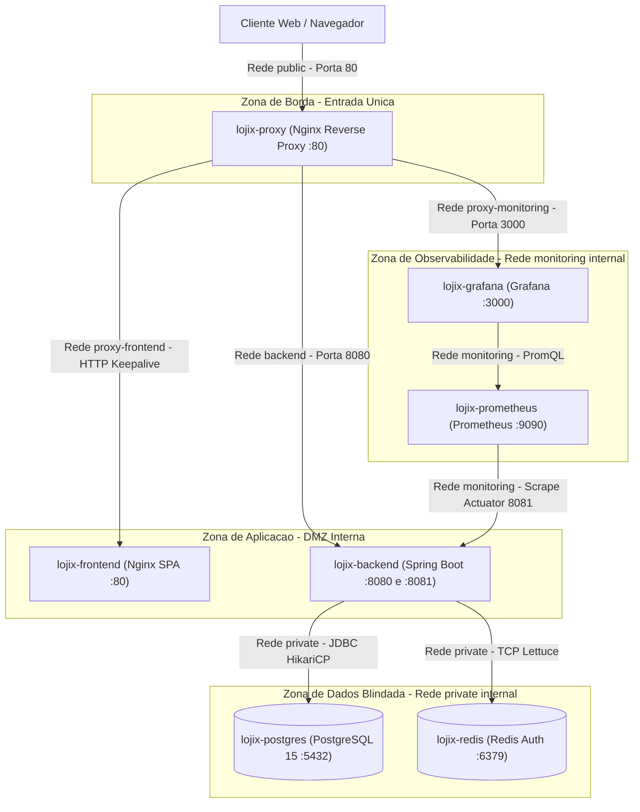

### Decisões de Isolamento e Hardening

| Rede | `internal` | Containers Conectados | Propósito de Segurança |
| :--- | :---: | :--- | :--- |
| `public` | `false` | `reverse-proxy`, `backend` | Permite entrada HTTP na porta `80` do Nginx e saída controlada da API para serviços externos (AWS S3 e SMTP). |
| `proxy-frontend` | `true` | `reverse-proxy`, `frontend` | Isola o servidor estático da SPA; o container React/Nginx não enxerga a API, o banco nem a internet. |
| `backend` | `true` | `reverse-proxy`, `backend` | Canal dedicado entre o gateway Nginx e a porta de aplicação `8080` do Tomcat. |
| `private` | `true` | `backend`, `postgres`, `redis` | **Camada de dados blindada.** Nem o `reverse-proxy`, nem o `frontend`, nem o host possuem rota para o PostgreSQL ou o Redis. |
| `monitoring` | `true` | `backend`, `prometheus`, `grafana` | Tráfego exclusivo de telemetria; o Prometheus coleta métricas na porta administrativa separada (`8081`). |
| `proxy-monitoring` | `true` | `reverse-proxy`, `grafana` | Permite servir os painéis do Grafana em `/grafana/` restrito por ACL de IPs privados no Nginx. |

**Boas práticas adicionais nos containers:**

1. **Execução Non-Root (`backend/Dockerfile`)**: O build *multi-stage* compila o artefato com `maven:3.9.9-eclipse-temurin-17` e copia apenas o `.jar` final para uma imagem enxuta `eclipse-temurin:17-jre-alpine`, criando explicitamente `appgroup` e `appuser` (`USER appuser`) para que o processo Java nunca rode como `root`.
2. **Separação de Porta de Gestão (`8081` vs `8080`)**: O Actuator responde na porta `8081` (`management.server.port=8081`). Assim, o proxy reverso encaminha `/api/*` apenas para `backend:8080`, tornando estruturalmente impossível que um cliente externo alcance endpoints internos do Actuator mesmo em caso de erro de roteamento.
3. **Orquestração Ordenada por Healthchecks Reais**: O `reverse-proxy` só inicia após `backend` e `grafana` reportarem `service_healthy`, e o `backend` só inicia após `pg_isready` no PostgreSQL e `redis-cli ping` autenticado no Redis responderem com sucesso, respeitando `start_period: 60s` para absorver o tempo de boot da JVM e migrações do Flyway.

---

## Hardening no Nginx Reverse Proxy

O Nginx (`nginx/nginx.conf`) atua como *Edge Gateway* na frente de toda a stack e concentra proteções de infraestrutura que evitam sobrecarregar a JVM desnecessariamente:

- **Rate Limiting contra Força Bruta no Login**: Define uma zona em memória compartilhada (`limit_req_zone $binary_remote_addr zone=auth_limit:10m rate=5r/s`) aplicada especificamente em `/api/auth/` com `burst=10 nodelay`, mitigando *credential stuffing* antes mesmo da requisição tocar o filtro do Spring Security e o hash BCrypt (que é propositalmente custoso em CPU).
- **Pool de Conexões Persistentes (`keepalive`)**: Configura `keepalive 32` nos upstreams com `proxy_http_version 1.1` e limpeza do header `Connection ""`, reaproveitando conexões TCP abertas entre Nginx e Tomcat e eliminando o custo repetitivo de *TCP three-way handshake* a cada chamada REST.
- **Interceptação Padronizada de Falhas de Upstream (`@api_gateway_error`)**: Caso o container da API esteja reiniciando (`502`, `503` ou `504`), o Nginx não devolve uma página HTML quebrada para o Axios no React, mas sim um JSON válido (`{"status":502,"error":"Bad Gateway","message":"..."}`).
- **Cache Imutável para Assets Estáticos da SPA**: No Nginx interno do frontend (`frontend/nginx.conf`), bundles versionados por hash em `/static/` recebem `Cache-Control: public, max-age=31536000, immutable`, enquanto `index.html` recebe `no-cache, no-store, must-revalidate` para garantir que novos deploys entrem em vigor imediatamente sem cache preso no navegador.
- **Headers de Segurança e Limite de Payload**: Aplica `X-Content-Type-Options: nosniff`, `X-Frame-Options: SAMEORIGIN`, `Referrer-Policy: strict-origin-when-cross-origin`, oculta versão do servidor (`server_tokens off`) e limita `client_max_body_size 10m`.

---

## Observabilidade com Prometheus, Grafana e Provisionamento de Templates

Em vez de depender apenas da leitura manual de logs, o Lojix instrumenta toda a aplicação com **Spring Boot Actuator + Micrometer**, exportando séries temporais consumidas pelo **Prometheus** a cada **5 segundos** (`prometheus.yml` apontando para `backend:8081/actuator/prometheus`).

### Provisionamento Declarativo (Zero Click-Ops)

Um problema recorrente ao subir Grafana em Docker é perder os datasources e painéis toda vez que o volume é recriado. Para resolver isso, tanto a conexão com o Prometheus quanto os **templates de dashboard do Grafana** são provisionados automaticamente como código ao iniciar o container:

- `grafana/provisioning/datasources/prometheus.yaml`: Registra automaticamente `http://prometheus:9090` como datasource default (`access: proxy`).
- `grafana/provisioning/dashboards/dashboards.yaml`: Mapeia o diretório `/etc/grafana/dashboards` no startup do Grafana.
- `grafana/dashboards/spring-boot-statistics.json`: Template completo de observabilidade para Spring Boot 3 / Micrometer já versionado no repositório, exibindo imediatamente ao abrir `http://localhost/grafana`:
  - **Saúde da JVM**: Uso de memória Heap/Non-Heap, threads vivas/bloqueadas, carga de CPU do processo e pausas do *Garbage Collector*;
  - **Tráfego HTTP**: Vazão de requisições por segundo (RPS), taxa de erros `4xx`/`5xx` e latência por endpoint;
  - **Pool HikariCP (`LojixHikariPool`)**: Conexões ativas vs. ociosas, tempo de aquisição de conexão e eventuais threads aguardando na fila (`pending`);
  - **Cache Redis**: Contadores de *cache hits* e *cache misses* por região (`produtosCache`, `categoriasCache`, `promocaoCache`).

---

## Governança Arquitetural com ArchUnit

Em projetos que crescem ao longo do tempo, a arquitetura planejada no início costuma sofrer erosão silenciosa: um desenvolvedor com pressa injeta um `Repository` direto no `Controller`, usa `@Autowired` em atributo privado ou deixa um `System.out.println` esquecido.

Para tornar as fronteiras arquiteturais **executáveis e verificáveis a cada commit**, o projeto utiliza **ArchUnit** (`ArchitectureTest.java`), validando o bytecode compilado durante a fase `test` do Maven:

```java
@AnalyzeClasses(packages = "com.example.lojix", importOptions = ImportOption.DoNotIncludeTests.class)
public class ArchitectureTest {

    @ArchTest
    static final ArchRule controllers_should_not_depend_on_repositories =
            noClasses().that().resideInAPackage("..controller..")
                    .should().dependOnClassesThat().resideInAPackage("..infrastructure.repository..");

    @ArchTest
    static final ArchRule domain_should_not_depend_on_outside =
            noClasses().that().resideInAPackage("..domain..")
                    .should().dependOnClassesThat().resideInAPackage("..controller..")
                    .orShould().dependOnClassesThat().resideInAPackage("..service..")
                    .orShould().dependOnClassesThat().resideInAPackage("..infrastructure..");

    @ArchTest
    static final ArchRule no_field_injection =
            noFields().that().areDeclaredInClassesThat().haveSimpleNameNotEndingWith("Impl")
                    .should().beAnnotatedWith(Autowired.class);
    // ... + 5 regras adicionais
}
```

| Regra ArchUnit | O que protege |
| :--- | :--- |
| `controllers_should_not_depend_on_repositories` | Impede atalhos que pulem regras de negócio, cache e controle transacional da camada `service`. |
| `domain_should_not_depend_on_outside` | Garante que entidades e enums de domínio permaneçam puros, sem acoplamento reverso com web, serviços ou infraestrutura. |
| `services_should_not_depend_on_controllers` | Assegura fluxo unidirecional de dependências e impede ciclos entre pacotes. |
| `controllers_must_be_suffixed_and_annotated` | Padroniza nomenclatura (`*Controller`) e anotação `@RestController`. |
| `services_must_be_suffixed_and_annotated` | Padroniza nomenclatura (`*Service`) e estereótipo `@Service`. |
| `no_field_injection` | Proíbe `@Autowired` em campos (exceto classes `*Impl` geradas pelo MapStruct), forçando **injeção via construtor** com campos `final` para imutabilidade e facilidade de teste. |
| `no_system_out_println` | Bloqueia uso de `System.out` / `System.err`, exigindo logging estruturado via SLF4J/Logback. |
| `no_generic_exceptions` | Proíbe lançar `Exception`, `RuntimeException` ou `Throwable` crus, forçando o uso de exceções semânticas de domínio tratadas no `@ControllerAdvice`. |

---

## Modelagem de Dados e Diagrama Entidade-Relacionamento

O schema relacional é versionado pelo **Flyway** (`V1__create_tables.sql`), mantendo `spring.jpa.hibernate.ddl-auto=none` em produção para que nenhuma alteração estrutural aconteça fora de migrações auditáveis.

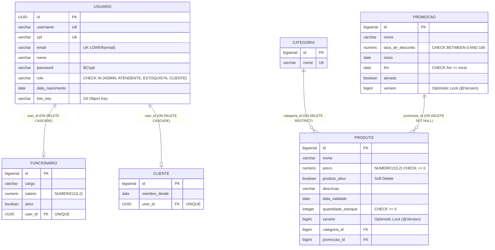

### Salvaguardas no Nível do Banco (PostgreSQL)

As validações não confiam apenas no código Java; o próprio DDL impõe invariantes de domínio:

- **UUID como PK em `usuario`**: Evita enumeração sequencial de identificadores de contas (`/usuarios/1`, `/usuarios/2`).
- **Índice Único Funcional Case-Insensitive**: `CREATE UNIQUE INDEX idx_usuario_email_lower ON usuario (LOWER(email))` impede duplicidade de cadastros mudando apenas maiúsculas/minúsculas.
- **Constraints `CHECK` Declarativas**: Garante no motor relacional que `preco >= 0`, `quantidade_estoque >= 0`, `taxa_de_desconto BETWEEN 0 AND 100` e `fim >= inicio` em promoções.
- **Políticas Explícitas de Foreign Key**:
  - `ON DELETE RESTRICT` em `produto.categoria_id`: impede apagar acidentalmente uma categoria que possua produtos vinculados;
  - `ON DELETE SET NULL` em `produto.promocao_id`: se uma promoção for removida, os produtos permanecem intactos e voltam automaticamente ao preço base;
  - **Soft Delete (`produto_ativo`)**: Produtos desativados saem de linha sem destruir referências históricas.
- **Precisão Monetária (`NUMERIC(10, 2)` + `BigDecimal`)**: Elimina erros de representação binária de ponto flutuante (`double`/`float`), utilizando `RoundingMode.HALF_UP` nos cálculos de desconto.

---

## Engenharia de Backend, Performance e Resiliência

### 1. Caching Distribuído no Redis com Invalidação Cirúrgica e `transactionAware`

Em produção (`@Profile("prod")`), o `RedisConfig` configura um `RedisCacheManager` utilizando `GenericJackson2JsonRedisSerializer` customizado com `JavaTimeModule` (suporte nativo a `LocalDate`/`LocalDateTime` em ISO-8601) e **TTLs diferenciados conforme a volatilidade de cada agregado**:

| Cache | TTL | Justificativa |
| :--- | :---: | :--- |
| `categoriasCache` | **12 horas** | Dados estruturais de baixíssima mutação durante o expediente. |
| `promocaoCache` | **60 minutos** | Campanhas promocionais alteradas pontualmente pela gerência. |
| `produtosCache` | **30 minutos** | Consultas frequentes por ID; equilibra baixa latência e frescor de estoque/preço. |
| `*PageCache` | **5 minutos** | Listagens paginadas administrativas com expiração curta. |

**Dois detalhes críticos de implementação:**

1. **Prevenção de *Cache Stampede* na Desativação de Promoções (`PromocaoService`)**: Ao desativar uma promoção vinculada a alguns produtos, a abordagem ingênua seria usar `@CacheEvict(value = "produtosCache", allEntries = true)`, derrubando o catálogo inteiro do Redis de uma só vez. Em vez disso, o serviço busca apenas os IDs afetados (`SELECT p.id FROM Produto p WHERE p.promocao.id = :promocaoId`) e invalida **cirurgicamente chave por chave**:
   ```java
   List<Long> idsProdutos = produtoRepository.findProdutoIdsByPromocaoId(idPromocao);
   Cache produtosCache = cacheManager.getCache("produtosCache");
   if (produtosCache != null) {
       idsProdutos.forEach(produtosCache::evict);
   }
   ```
2. **Sincronia com Transações JPA (`.transactionAware()`)**: O `RedisCacheManager` é construído com `.transactionAware()`. Assim, comandos de escrita/remoção no Redis só são disparados **após o commit efetivo da transação no PostgreSQL**, evitando que um *rollback* deixe dados fantasmas ("sujos") cacheados em memória.

### 2. Dimensionamento do Pool HikariCP e Detecção de Vazamentos

Um erro comum é configurar pools de banco com `50` ou `100` conexões achando que "quanto mais, mais rápido", o que na verdade degrada o PostgreSQL por *context switching* excessivo de processos e contenção de I/O.

Seguindo a fórmula clássica recomendada pela documentação do PostgreSQL e do próprio HikariCP (`conexões = (núcleos * 2) + discos`), o pool `LojixHikariPool` foi dimensionado em `application-prod.properties` para o perfil real de até 20 operadores administrativos simultâneos:

```properties
spring.datasource.hikari.pool-name=LojixHikariPool
spring.datasource.hikari.maximum-pool-size=${HIKARI_MAX_POOL_SIZE:12}
spring.datasource.hikari.minimum-idle=${HIKARI_MIN_IDLE:5}
spring.datasource.hikari.connection-timeout=20000
spring.datasource.hikari.idle-timeout=300000
spring.datasource.hikari.max-lifetime=1200000
spring.datasource.hikari.leak-detection-threshold=15000
```

Como requisições REST bem otimizadas retêm uma conexão JDBC por poucos milissegundos, **12 conexões ativas** suportam centenas de transações por segundo com folga, enquanto `leak-detection-threshold=15000` emite alerta automático com *stack trace* caso qualquer transação segure uma conexão por mais de 15 segundos.

### 3. Eliminação de Queries *N+1* e Paginação Segura no Hibernate

- **Constructor Expression Projections (`ClienteRepository`)**: Listagens paginadas usam projeção direta para DTO em JPQL (`SELECT new ...ClienteResponseDTO(...) FROM Cliente c JOIN c.usuario u`), trazendo apenas as colunas necessárias em uma única viagem ao banco e sem custo de *dirty checking* de entidades gerenciadas.
- **`JOIN FETCH` com `countQuery` Desacoplada (`ProdutoRepository`)**: Nas consultas paginadas de produtos com `Categoria` e `Promocao`, o uso de `JOIN FETCH` junto com `Pageable` exige uma `countQuery` explícita sem `FETCH`. Sem isso, o Hibernate emite o alerta `HHH90003004` e carrega toda a tabela na memória da JVM para paginar. Separar as duas queries resolve o *N+1* mantendo paginação `LIMIT/OFFSET` nativa no SQL.
- **Teto Global contra Ataques de OOM (`application.properties`)**: `spring.data.web.pageable.max-page-size=50` bloqueia tentativas de passar `?size=9999999` para exaurir o Heap da aplicação.

### 4. Concorrência Web via Optimistic Locking (`HTTP 409 Conflict`)

As entidades `Produto` e `Promocao` possuem controle de versão otimista (`@Version`). Se dois operadores abrirem a tela do mesmo produto e tentarem salvar edições conflitantes de preço ou estoque, a segunda requisição dispara `ObjectOptimisticLockingFailureException`, interceptada globalmente pelo `CustomExceptionHandler` e convertida em **`HTTP 409 Conflict`** orientando o operador a recarregar os dados atualizados, evitando o problema de *Lost Update* sem bloquear linhas no banco.

### 5. Uploads Seguros no AWS S3 (Magic Bytes + Presigned URLs + Timeouts)

O armazenamento de fotos de perfil (`S3StorageService` + `S3Config`) aplica múltiplas camadas de segurança e resiliência com o **AWS SDK v2**:

1. **Validação Binária por *Magic Bytes***: Confiar apenas em `MultipartFile.getContentType()` ou na extensão do nome do arquivo é inseguro, pois ambos são facilmente forjados pelo cliente (*MIME Spoofing*). O `validarMagicBytes` inspeciona os primeiros bytes hexadecimais reais do arquivo (`FF D8 FF` para JPEG, `89 50 4E 47` para PNG e assinatura `RIFF....WEBP` para WebP) antes de aceitar o upload.
2. **Prevenção de *Path Traversal***: O nome original enviado pelo usuário é descartado; a chave no bucket segue o padrão determinístico `usuarios/{usuarioId}/foto-perfil.{ext}`.
3. **Bucket 100% Privado com Presigned URLs**: Os objetos no S3 não são públicos. A leitura ocorre por meio de URLs temporárias assinadas criptograficamente pelo `S3Presigner` (`aws.s3.presigned-url-expiration-minutes`).
4. **Timeouts Fail-Fast no Cliente HTTP da AWS**: `S3Config` define `apiCallTimeout(10s)` e `apiCallAttemptTimeout(5s)`, impedindo que uma degradação externa na rede da AWS congele threads do Tomcat indefinidamente.

### 6. Notificações de E-mail Assíncronas e Isolamento de Falhas (`@Async` + LGPD)

Ao cadastrar um novo cliente no balcão, o `ClienteService` aciona o envio de um e-mail HTML de boas-vindas (`SmtpEmailService`):

- **Processamento Não-Bloqueante (`@Async`)**: O operador da loja recebe a resposta `201 Created` em milissegundos, enquanto a negociação TLS/SMTP ocorre em thread separada.
- **Isolamento de Falhas e Degradação Graciosa**: O serviço opera com *feature toggle* (`app.mail.enabled`) — simulando o disparo em log nos ambientes sem credenciais SMTP — e encapsula falhas de rede para que uma indisponibilidade do provedor de e-mail **jamais cause rollback** no cadastro do cliente já salvo no banco.
- **Privacidade por Design (LGPD)**: Utilitário `MaskUtils.maskCpf(...)` mascara o CPF tanto nos logs estruturados da aplicação quanto no corpo do e-mail enviado (`***.456.789-**`), evitando exposição de dados pessoais sensíveis.

### 7. MapStruct em Compile-Time e Bean Validation Customizada

- **MapStruct (`*Mapper`)**: Toda conversão Entidade ↔ DTO é gerada em código Java puro em tempo de compilação (sem overhead de *reflection* como no `ModelMapper`), utilizando `@AfterMapping` no `ProdutoMapper` para calcular dinamicamente o `precoPromocional` caso a promoção associada esteja ativa e dentro da janela de datas `inicio`/`fim`.
- **Annotation Customizada `@MaiorDeIdade`**: Implementa `ConstraintValidator<MaiorDeIdade, LocalDate>` (`MaiorDeIdadeValidator`) integrada nativamente ao ciclo do Jakarta Bean Validation (`@Valid`), barrando cadastros de menores de 18 anos já na borda do DTO com retorno estruturado `400 Bad Request`.

---

## Frontend em React Puro, CSS Modules e Decisões de UX

O frontend foi construído deliberadamente em **React 18 puro**, sem bibliotecas pesadas de componentes prontos (sem Material UI, Ant Design, Bootstrap ou Tailwind):

- **Bundle Enxuto (~90 kB gzipped)**: Sem dependências visuais inchadas, o carregamento inicial é imediato mesmo em redes modestas.
- **Isolamento de Estilos com CSS Modules (`*.module.css`)**: Todos os componentes e páginas utilizam escopo local gerado no build, eliminando colisão global de classes CSS e facilitando manutenção modular.
- **Gestão de Estado Assíncrono com TanStack React Query v5**: Substitui cascatas manuais de `useEffect` + `useState` por cache declarativo no cliente (`staleTime: 5 min`), controle de estados de carregamento (`isFetching`) e invalidação automática (`invalidateQueries`) após cadastros e edições.
- **Axios Interceptors + Rotas Protegidas por Papel (`ProtectedRoute`)**: Injeção automática do token Bearer JWT e redirecionamento imediato em caso de sessão expirada (`401`), além de filtragem visual e funcional das rotas conforme a role do colaborador autenticado.
- **Refinamento de UX Voltado à Operação de Loja**:
  - **Remoção de Ruído Técnico**: IDs internos de banco foram removidos de listagens como Categorias, priorizando atributos significativos para o operador.
  - **Cadastro de Cliente sem Atrito no Balcão**: Clientes da loja não fazem login no painel administrativo; por isso, campos de `usuário` e `senha` foram eliminados do modal de Novo Cliente (sendo gerados internamente de forma transparente para manter o contrato relacional), restando apenas Nome, CPF com máscara dinâmica, Data de Nascimento e E-mail.
  - **Indicadores Visuais de Operação**: Formatação monetária em Real (`Intl.NumberFormat('pt-BR')`), badges coloridos por nível de acesso e alertas visuais automáticos na tabela de produtos para **estoque crítico (≤ 5 unidades / esgotado)** e **validade vencida ou próxima do vencimento (≤ 15 dias)**.

---

## Estratégia de Testes Automatizados

Diferente de projetos que testam apenas mocks isolados, a suíte do backend conta com **56 testes automatizados** combinando **testes de arquitetura (ArchUnit)**, **testes unitários de infraestrutura** e **testes de integração ponta a ponta (`@SpringBootTest` + `MockMvc`)** rodando no perfil `test` com `@Transactional` (garantindo *rollback* automático e isolamento total entre cenários).

Para manter os testes legíveis e evitar duplicação de código de setup, foi implementado o padrão **Test Data Builder** (`UsuarioTestBuilder`, `FuncionarioTestBuilder`, `ClienteTestBuilder`, `ProdutoRequestDTOBuilder`, `AuthTestFactory`) aliado a um *Test Double* para armazenamento em nuvem (`MockStorageService`).

| Classe de Teste | Testes | Escopo Validado |
| :--- | :---: | :--- |
| `ArchitectureTest` | 8 | Isolamento entre `controller`, `service`, `domain` e `repository`, proibição de *field injection*, `System.out` e exceções genéricas. |
| `FuncionarioControllerTest` | 9 | Fluxo completo de colaboradores, autorização RBAC (`ADMIN` vs demais roles), validação de CPF/idade (`@MaiorDeIdade`) e conflitos. |
| `PromocaoControllerTest` | 8 | Criação, listagem paginada, associação com produtos, cálculo de desconto e desativação com invalidação de cache. |
| `CategoriaControllerTest` | 7 | Cadastro, unicidade de nome, paginação, edição e restrições de permissão por perfil. |
| `ProdutoControllerTest` | 7 | CRUD completo de catálogo, filtro por categoria, soft delete, validações de preço/estoque e autenticação JWT. |
| `AuthControllerTest` | 6 | Autenticação com credenciais válidas/inválidas, emissão de token JWT e bloqueio de rotas protegidas (`401`/`403`). |
| `ClienteControllerTest` | 6 | Cadastro de clientes, unicidade de CPF, paginação com projeção DTO e consulta por ID. |
| `S3StorageServiceTest` | 4 | Upload válido, rejeição por tamanho máximo excedido, tipo inválido e inspeção de assinatura binária (*Magic Bytes*). |
| `LojixApplicationTests` | 1 | Smoke test de subida íntegra do contexto do Spring Boot no perfil de testes. |
| **Total** | **56** | |

---

## CI/CD, Qualidade de Código (SonarCloud) e Deploy

### Pipelines Isoladas no GitHub Actions

O repositório possui **3 workflows independentes** em `.github/workflows/` configurados com filtros de caminho (`paths`) e cancelamento automático de execuções concorrentes obsoletas (`concurrency.cancel-in-progress: true`), evitando gastar minutos de CI em áreas que não foram tocadas no commit:

1. **`backend-ci.yml`**: Compila o projeto em Java 17 com cache Maven, executa toda a suíte de **56 testes (incluindo ArchUnit)**, gera o relatório XML de cobertura com **JaCoCo** e envia a análise estática de qualidade, *code smells* e vulnerabilidades (SAST) para o **SonarCloud**.
2. **`frontend-ci.yml`**: Instala dependências limpas via `npm ci` em Node 18, executa testes e valida o build otimizado de produção (`npm run build`).
3. **`docker-ci.yml`**: Valida o schema estrutural do `docker-compose.yml` (`docker compose config -q`) e testa a sintaxe real dos arquivos de configuração do Nginx (`nginx -t`) dentro de containers `nginx:alpine` efêmeros.

### Ambientes de Deploy em Nuvem

- **Frontend — Vercel ([lojix-frontend.vercel.app](https://lojix-frontend.vercel.app/))**: Deploy contínuo da SPA React servida via Edge CDN global com HTTPS nativo.
- **Backend — Render**: Deploy containerizado da API Spring Boot conectada ao banco PostgreSQL em nuvem sob perfil de produção.

---

## Estrutura do Projeto

```text
lojix/
├── .github/workflows/          # Pipelines CI isoladas (backend-ci, frontend-ci, docker-ci)
├── assets/                     # Capturas de tela das interfaces do sistema
├── backend/
│   ├── src/main/java/com/example/lojix/
│   │   ├── common/             # Handler global de exceções (HTTP 409/400/401) e @MaiorDeIdade
│   │   ├── config/             # Configurações de Redis, AWS S3 (Timeouts), CORS e OpenAPI
│   │   ├── controller/         # Controllers RESTful finos
│   │   ├── domain/             # Entidades JPA (@Entity, @Version) e Enums (UserRole)
│   │   ├── dto/                # Contratos de entrada/saída e validações Jakarta
│   │   ├── infrastructure/     # Repositórios JPA, S3StorageService, SmtpEmailService, JWT Security
│   │   ├── mapper/             # Interfaces MapStruct geradas em tempo de compilação
│   │   ├── service/            # Regras de negócio, transações e orquestração de cache
│   │   └── util/               # Utilitários (ex: MaskUtils para proteção de CPF/LGPD)
│   ├── src/main/resources/
│   │   ├── db.migration/       # Migrações SQL versionadas pelo Flyway
│   │   ├── application.properties
│   │   ├── application-dev.properties
│   │   └── application-prod.properties
│   ├── src/test/java/          # Suíte JUnit 5, MockMvc, ArchUnit e Test Data Builders
│   └── Dockerfile              # Build multi-stage Maven -> JRE 17 Alpine (non-root)
├── frontend/
│   ├── src/
│   │   ├── components/         # Layout, Navbar, Modal, ProtectedRoute (CSS Modules)
│   │   ├── context/            # Contexto de sessão e autenticação JWT
│   │   ├── pages/              # Dashboard, Produtos, Categorias, Promoções, Funcionários, Clientes
│   │   └── services/           # Cliente Axios e interceptors HTTP
│   ├── nginx.conf              # Servidor SPA com cache imutável em /static/
│   └── Dockerfile              # Build multi-stage Node 18 -> Nginx Alpine
├── grafana/
│   ├── dashboards/             # Template JSON (spring-boot-statistics.json)
│   └── provisioning/           # Provisionamento automático de datasources e dashboards
├── nginx/
│   └── nginx.conf              # Reverse Proxy (rate-limit, keepalive, gzip, security headers)
├── docker-compose.yml          # Orquestração dos 7 serviços e 6 redes isoladas
├── prometheus.yml              # Configuração de scrape no Actuator (:8081)
└── .env.example                # Exemplo documentado de variáveis de ambiente
```

---

## Como Executar Localmente

### Opção 1: Stack Completa com Docker Compose (Recomendado)

Sobe todos os 7 containers (`reverse-proxy`, `frontend`, `backend`, `postgres`, `redis`, `prometheus` e `grafana`) com as redes internas e dashboards provisionados:

```bash
# 1. Clone o repositório
git clone https://github.com/queirogaraffael/lojix.git
cd lojix

# 2. Crie o arquivo .env a partir do modelo e ajuste as senhas se desejar
cp .env.example .env

# 3. Construa as imagens e suba toda a stack em background
docker compose up -d --build

# 4. Verifique o status de saúde dos containers
docker compose ps
```

- **Aplicação Web (via Nginx Reverse Proxy):** `http://localhost`
- **Dashboards do Grafana:** `http://localhost/grafana` (usuário `admin` e senha definida em `GF_ADMIN_PASSWORD` no `.env`)
- **Healthcheck do Gateway:** `http://localhost/healthz`

*(No primeiro boot, o `UserAdminInitializer` cria de forma idempotente o usuário administrador inicial definido pelas variáveis `ADMIN_USERNAME` e `ADMIN_PASSWORD` do `.env`).*

### Opção 2: Execução em Modo Desenvolvimento (Sem Docker)

O perfil `dev` utiliza banco **H2 em memória**, cache local simplificado e habilita o **Swagger UI** (`/swagger`), permitindo rodar e depurar rapidamente na máquina local sem depender de PostgreSQL ou Redis externos:

```bash
# Terminal 1 — Backend (porta 8080)
cd backend
./mvnw spring-boot:run -Dspring-boot.run.profiles=dev

# Terminal 2 — Frontend (porta 3000)
cd frontend
npm install
npm start
```

---

## Imagens do Sistema

### Autenticação e Dashboard Administrativo

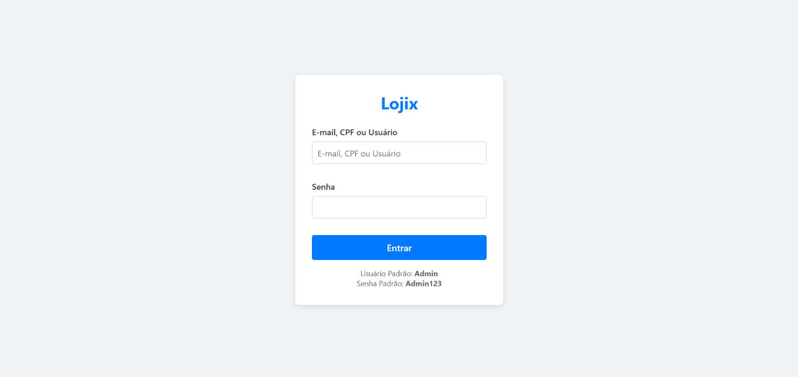
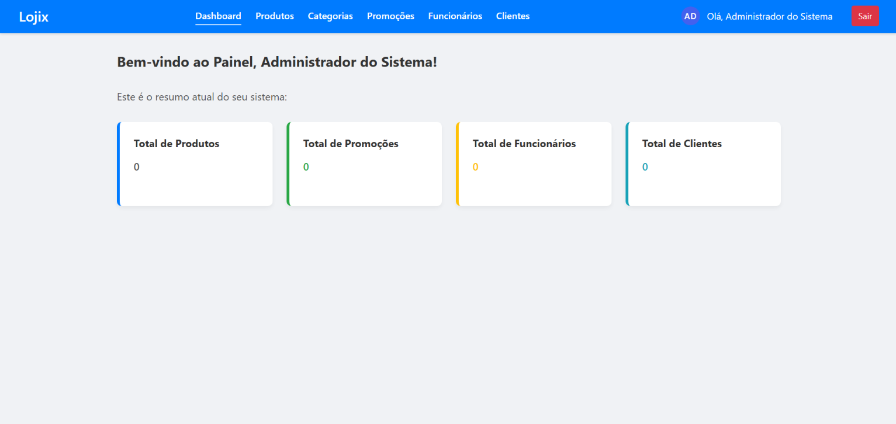

### Gestão de Produtos e Promoções

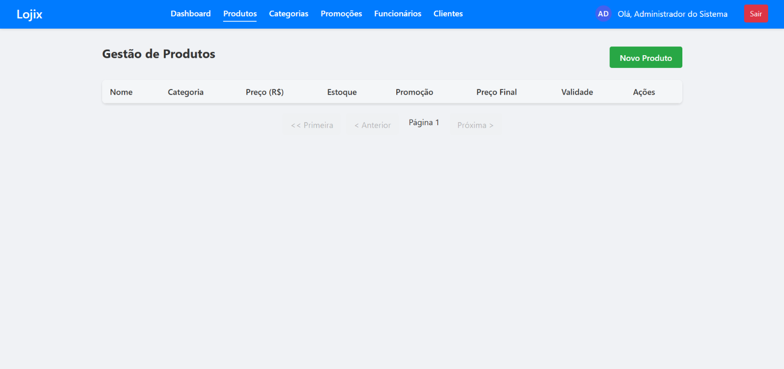
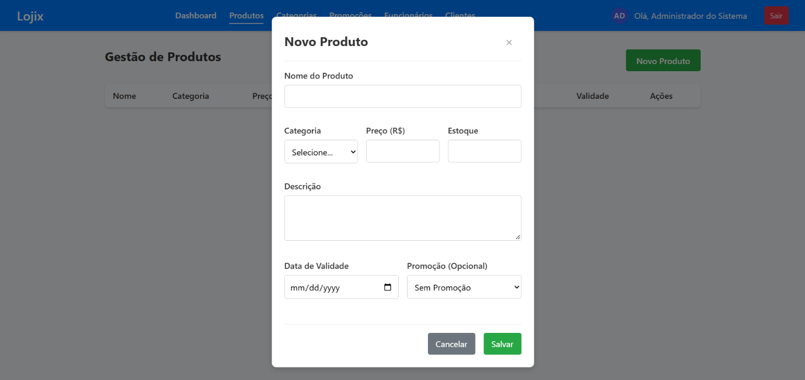
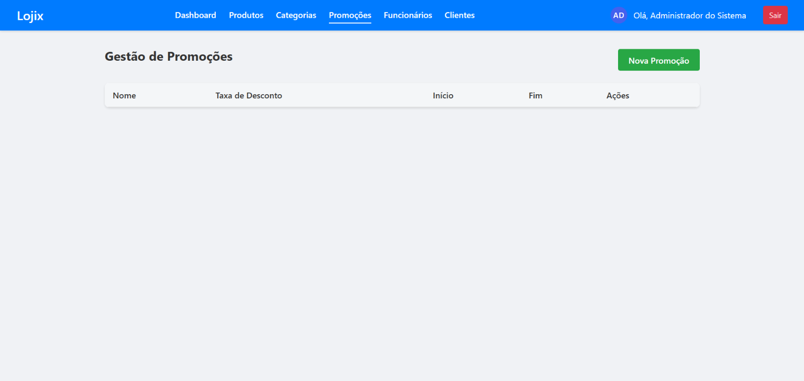
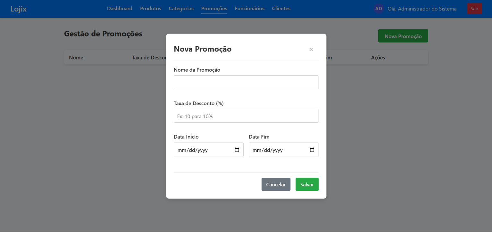

### Gestão de Categorias (Sem Exposição de IDs Internos)

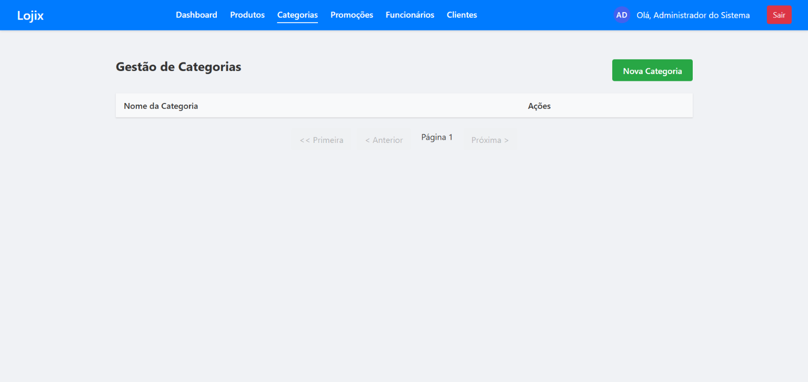
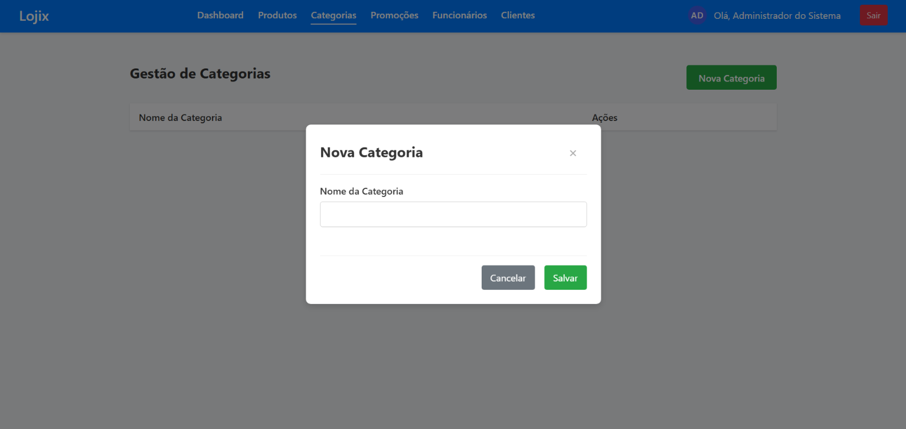

### Gestão de Funcionários e Clientes de Balcão

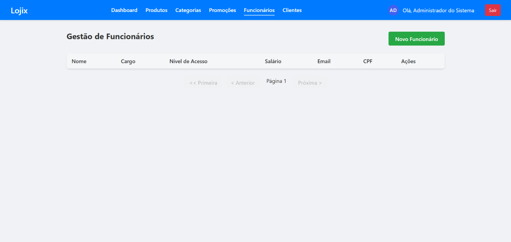
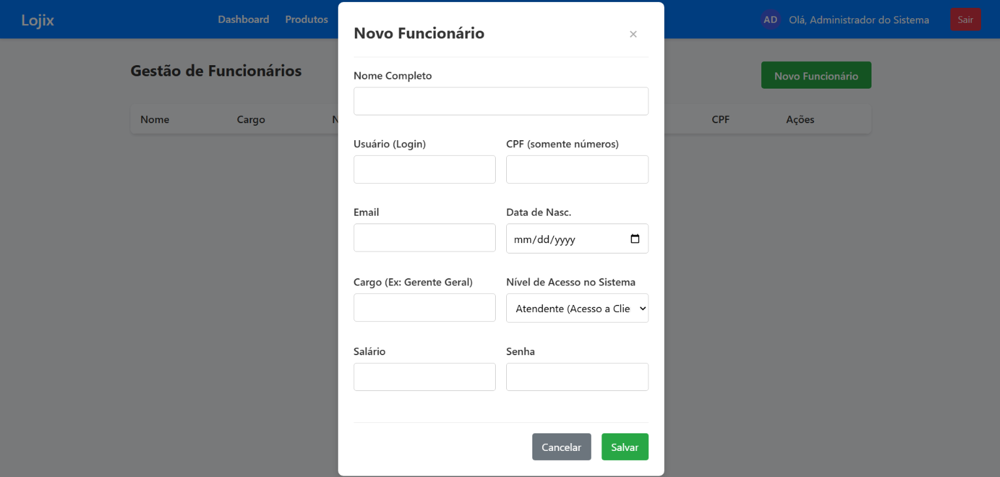
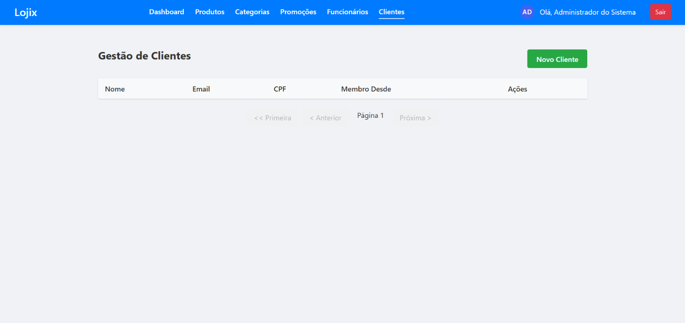
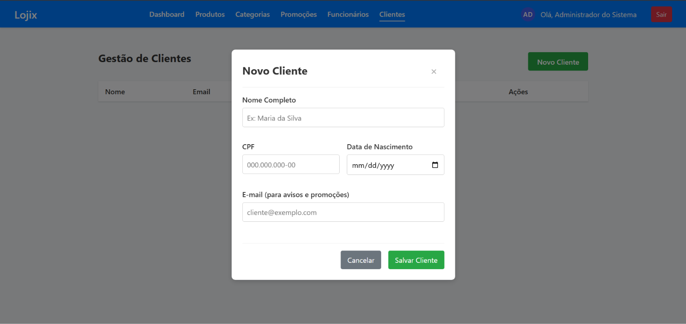

---

## Evolução e Comparativo entre Projetos

Para contextualizar minha evolução técnica em arquitetura de software e infraestrutura dentro do domínio de varejo, o **Lojix** representa o próximo passo natural após o [Self-Checkout Retail Desktop](https://github.com/queirogaraffael/self-checkout-retail-desktop).

Enquanto no projeto anterior o objetivo foi implementar **manualmente em Java puro + Hibernate + Swing** tudo o que um framework moderno abstrai (container de IoC manual, ciclo de vida explícito do `EntityManagerFactory`, controle manual de sessão com threads daemon e retry com *Exponential Backoff + Jitter*), no **Lojix** o foco foi dominar o ecossistema **Spring Boot em nível de produção**, compreendendo exatamente o que acontece por baixo das abstrações e adicionando camadas reais de arquitetura distribuída:

| Dimensão Técnica | Self-Checkout Retail Desktop | Lojix — Store Manager Pro |
| :--- | :--- | :--- |
| **Arquitetura e Interface** | Desktop MVC (Swing) | Arquitetura em Camadas Estrita + DIP nas integrações (REST API) + SPA em React Puro (CSS Modules) |
| **Injeção de Dependência e Persistência** | IoC manual + `EntityManager` isolado por tentativa | Spring IoC (construtor estrito validado por ArchUnit) + Spring Data JPA + Flyway + HikariCP calibrado |
| **Concorrência** | Optimistic Locking (`@Version`) + Retry com Backoff Exponencial e Jitter | Optimistic Locking (`@Version`) traduzido para semântica REST (`HTTP 409 Conflict`) |
| **Performance e Cache** | Batch `SELECT ... IN` no MySQL | Redis distribuído (`transactionAware`, TTLs por agregado e invalidação cirúrgica) + MapStruct + `JOIN FETCH` |
| **Infraestrutura e Redes** | Uma JVM local por terminal | 7 containers orquestrados em **6 redes Docker isoladas (DMZ)** + Nginx Reverse Proxy |
| **Observabilidade** | Logs locais | **Prometheus + Grafana** com templates e datasources provisionados como código |
| **Integrações Externas** | Geração de NF em arquivo local | **AWS S3** (Magic Bytes + Presigned URLs) e **SMTP Assíncrono (`@Async`)** |
| **Qualidade, Testes e CI/CD** | 30 testes unitários (JUnit 4 + Mockito) | **56 testes** (Integração `MockMvc` + Unitários + **ArchUnit**) em pipelines GitHub Actions + JaCoCo + SonarCloud + Deploy (Vercel/Render) |

Construir primeiro os mecanismos "na unha" sem Spring no projeto desktop e depois projetar o Lojix com Spring Boot, Redis, S3, redes Docker segmentadas e observabilidade tornou cada configuração deliberada — sabendo exatamente qual problema cada ferramenta resolve e quais *trade-offs* ela introduz.

---

## Licença

Distribuído sob a Licença MIT. Desenvolvido por [Raffael Queiroga](https://github.com/queirogaraffael).
